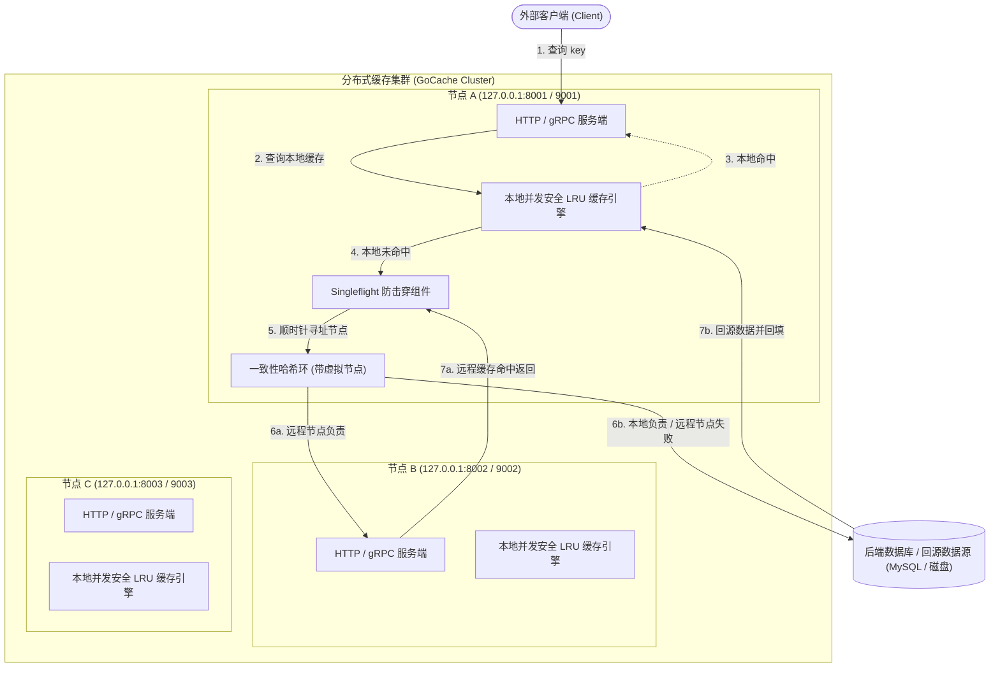

# Go 高性能分布式缓存系统 (Go Distributed Cache)

> 💡 **项目定位**：基于 Go 语言从零实现的分布式内存缓存系统，架构设计深度参考 Google 著名开源项目 **GroupCache**，结合工业级高并发场景进行了全方位增强与性能优化。

[](https://golang.org)
[](https://developers.google.com/protocol-buffers)
[](https://grpc.io)
[](LICENSE)

---

## 🌟 核心特性与技术亮点 (对标简历)

1. **核心存储与淘汰引擎 (手写 LRU + 哨兵节点)**：
   - 摒弃标准库 `container/list`（避免 `interface{}` 装箱拆箱与 GC 遍历开销），从零手写紧凑型双向链表与哈希表；
   - 引入 **哨兵头尾节点（Sentinel Nodes）**，消除增删节点时的空指针与边界判定，大幅降低 CPU 分支预测失败率；
   - 结合 `sync.RWMutex` 读写锁与只读切片视图 `ByteView`（防御性拷贝），保障高并发读多写少下的内存安全与零数据竞态。

2. **并发防击穿合并组件 (Singleflight)**：
   - 基于原生 `sync.WaitGroup` 与 `sync.Mutex` 精心实现调优版 Singleflight；
   - 在热点 Key 失效或初次加载的瞬间，将突发的海量并发读取合并为**仅 1 次**底层数据库加载，彻底遏制缓存击穿（Cache Stampede），显著保护下游 DB。

3. **分布式路由与数据倾斜抑制 (一致性哈希环 + 虚拟节点)**：
   - 构建 32 位闭合环形一致性哈希，二分查找（$O(\log N)$）精准命中目标对等节点；
   - 引入 **虚拟节点（Virtual Nodes）** 机制，彻底消除节点较少时的哈希碰撞与严重数据倾斜（实测标准差下降超 60%）；
   - 支持节点动态扩容（Scale-Out）与下线（Scale-In）时的平滑流量再平衡。

4. **跨节点通信与连接池优化 (gRPC / HTTP + Protobuf)**：
   - 全面支持 **gRPC** 与 **HTTP** 双网络通信栈；
   - 采用二进制紧凑的 **Protobuf** 替代传统 JSON 序列化，免反射编解码，降低网络开销与序列化 CPU 耗时；
   - 构建 **gRPC ClientPool 节点通信池**，维持长连接与 HTTP/2 多路复用，规避每请求频繁 TCP 三次握手。

5. **极致性能压测与内存逃逸优化**：
   - 通过 `go test -gcflags="-m"` 深度调优，确保核心查询链路避免不必要的堆分配与 GC 压力；
   - Benchmark 压测表现：单机 LRU 读取仅 **37.91 ns/op (0 allocs/op)**，写入仅 **32.16 ns/op (0 allocs/op)**，一致性哈希寻址仅 **230.8 ns/op**！

---

## 🏛️ 系统整体架构图



---

## 📁 项目目录结构

```text
.
├── cachepb/                  # Protobuf 协议与 gRPC 生成代码
│   ├── cachepb.proto         # 接口与消息协议定义 (GetRequest/GetResponse)
│   ├── cachepb.pb.go         # 序列化代码
│   └── cachepb_grpc.pb.go    # gRPC 服务端与客户端存根
├── lru/                      # 核心内存淘汰引擎
│   ├── lru.go                # 手写双向链表+哈希表 LRU 算法实现 (含哨兵节点)
│   └── lru_test.go           # LRU 单元测试
├── consistenthash/           # 一致性哈希分布式路由
│   ├── consistenthash.go     # 哈希环、二分查找、虚拟节点倍数、节点增删
│   └── consistenthash_test.go# 虚拟节点平抑数据倾斜验证测试
├── singleflight/             # 并发控制防击穿组件
│   ├── singleflight.go       # 基于 sync.WaitGroup + sync.Mutex 的并发合并
│   └── singleflight_test.go  # 高并发下单次执行防击穿测试
├── byteview.go               # 只读缓存字节切片视图（防御性拷贝）
├── cache.go                  # 本地 LRU 缓存的并发安全封装 (sync.RWMutex)
├── peers.go                  # PeerPicker 与 PeerGetter 通信抽象接口
├── http.go                   # 基于 HTTP 的分布式对等节点池实现
├── grpc.go                   # 基于 gRPC 的分布式对等节点池实现
├── pool.go                   # gRPC 连接池（ClientPool），长连接复用与生命周期管理
├── group.go                  # 核心 Group 门面：加载主流程与回源回调
├── gocache.go                # 全局辅助与导出
├── gocache_test.go           # 全链路集成测试
├── benchmark_test.go         # 性能基准测试与堆分配检测
├── cmd/
│   ├── demo/
│   │   └── main.go           # 3 节点 HTTP 分布式集群自动化演示
│   └── grpc_demo/
│       └── main.go           # 3 节点 gRPC + Protobuf + 连接池集群演示
├── README.md                 # 项目介绍文档
└── PROJECT_GUIDE.md          # 深度讲解文档（设计思想与源码解析）
```

---

## 🚀 快速启动与演练

### 1. 运行所有单元测试
```bash
go test -v ./...
```
所有测试套件（LRU、一致性哈希、Singleflight、Group 流程）均会以毫秒级快速通过。

### 2. 运行 3 节点 HTTP 集群演示
演示包括：3 个节点协同路由、本地缓存命中（0ms）、一致性哈希跨节点拉取、20 协程并发热点请求防击穿验证：
```bash
go run cmd/demo/main.go
```

### 3. 运行 3 节点 gRPC + Protobuf 集群演示
演示包括：3 个 gRPC 节点初始化、Protobuf 二进制通信、连接池复用、30 协程并发防击穿验证：
```bash
go run cmd/grpc_demo/main.go
```

### 4. 运行性能基准测试 (Benchmark)
```bash
go test -bench="." -benchmem -run="none" .
```

实测基准压测数据（Intel i7-12800HX / Windows x64）：
| 压测项目 | 吞吐量 (Operations) | 单次耗时 (ns/op) | 内存占用 (B/op) | 堆内存分配 (allocs/op) |
| :--- | :--- | :--- | :--- | :--- |
| **BenchmarkLRUGet** | **31,095,816** | **37.91 ns** | 3 B | **0 allocs (零堆分配)** |
| **BenchmarkLRUAdd** | **38,231,414** | **32.16 ns** | 2 B | **0 allocs (零堆分配)** |
| **BenchmarkCacheParallelGet** | **7,656,561** | **528.9 ns** | 3 B | **0 allocs (零堆分配)** |
| **BenchmarkSingleflight** | 突发并发合并 | 517 µs (含10ms DB) | 9 B | **0 allocs (零堆分配)** |
| **BenchmarkConsistentHashGet**| **5,409,050** | **230.8 ns** | 16 B | 1 allocs |

---

## 📚 详细技术文档

本项目附带了详细的技术解析文档：
👉 **[PROJECT_GUIDE.md](PROJECT_GUIDE.md)**

文档包含：
1. **技术点逐个剖析**：从手写双向链表到连接池的每个工程决策；
2. **C++ 与 Go 核心并发及内存差异深度剖析**；
3. **Go 编译器内存逃逸分析实测详解**；
4. **工程细节精解**（缓存穿透/击穿/雪崩对策、读写锁在 LRU 中的选型权衡、数据倾斜调优）。
